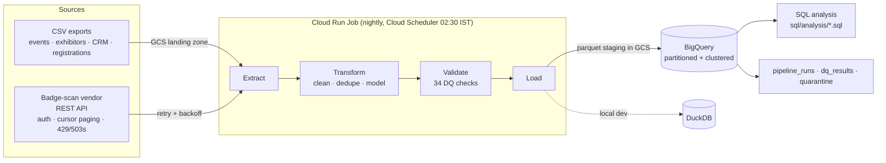
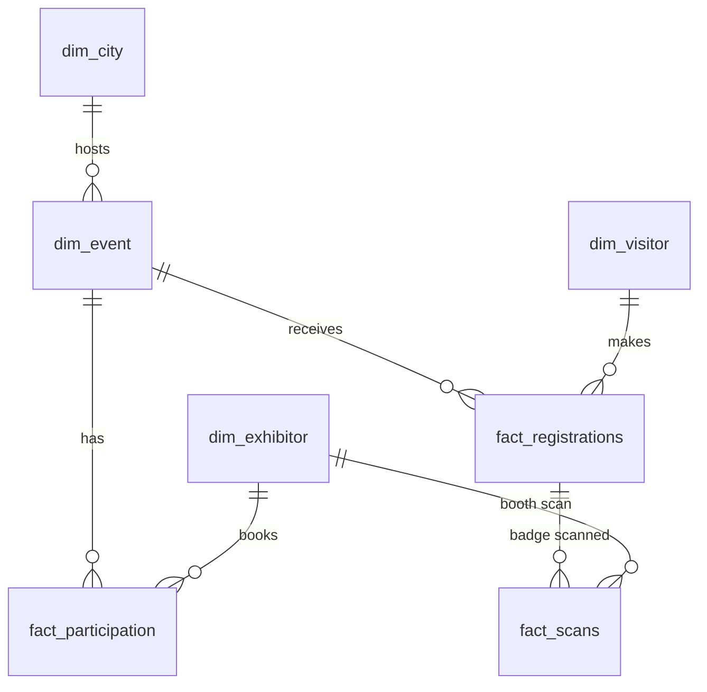

# Event Analytics Pipeline (Python · SQL · GCP)

An end-to-end data pipeline for a **trade-exhibition business** that runs metro shows in tier 1 cities and a regional series in tier 2/3 markets. It pulls registration, CRM and exhibitor exports plus badge-scan data from a vendor REST API, cleans and models it into a star schema, loads it into **BigQuery** on a nightly **Cloud Run** job, and answers real business questions with **advanced SQL**.

Everything also runs locally against DuckDB, so it can be demoed without a GCP account.

```
python data_gen/generate.py          # ~80k registrations, ~600k badge scans, deliberately messy
bash scripts/run_local.sh            # mock API -> ETL -> warehouse -> 12 SQL reports (≈1 min)
```

---

## Architecture



| Layer | Local | GCP |
|---|---|---|
| Raw landing zone | `data/raw/*.csv` | `gs://<bucket>/raw/` |
| Vendor API | `uvicorn` on :8000 | Cloud Run service `scan-api` |
| Pipeline | `python -m pipeline.main` | Cloud Run job `event-pipeline`, triggered by Cloud Scheduler |
| Warehouse | DuckDB file | BigQuery dataset `event_analytics` (asia-south1) |
| Secrets | `.env` | Secret Manager (`scan-api-key`, `pii-salt`) |

## What the pipeline actually handles

The generator produces the kind of mess real source systems have, and the transform step fixes it:

| Problem in the source data | How it's handled |
|---|---|
| City spelled `Bombay`, `mumbai `, `B'lore`, `Cochin` | Alias map → one IATA city code |
| Phones as `098…`, `+91-98…`, `91 98…` | Normalised to E.164, only last 4 digits kept |
| Same person in the CRM twice (email in different case) | Merged on normalised email (phone as fallback); registrations re-pointed |
| Double-submitted registration forms | Keep the first per person per show |
| Dates as `2025-02-14 10:23:11`, `14/02/2025 10:23`, ISO with offset | Explicit format list, never day/month guessing |
| Amounts as `₹1,500`, `INR 1500`, `1500.00`, blank | Parsed to numbers; negatives nulled and logged |
| Scan devices reporting UTC (`…Z`) vs IST | Everything stored as IST `DATETIME` |
| Exhibitor scanning the same badge twice within seconds | Collapsed (2-minute window) |
| Orphan badges, test accounts | Moved to a `quarantine` table with the reason |
| Flaky vendor API (5% 503/429) | Exponential backoff with jitter, honours `Retry-After`, never retries 4xx |

A **data-quality gate** (primary keys, not-nulls, foreign keys, attendance-rate sanity, quarantine < 5%) runs before loading. Any `error` aborts the load; every run is logged to `pipeline_runs` and `dq_results`.

PII minimisation: names aren't loaded; emails are stored only as a salted SHA-256.

## Data model



| Table | Grain | BigQuery design |
|---|---|---|
| `fact_scans` | one gate entry or booth scan | partitioned by `scan_date`, clustered by `event_id, scan_type, exhibitor_id` |
| `fact_registrations` | one registration (with derived `attended`, `lead_days`, `lead_bucket`) | partitioned by `registration_date`, clustered by `event_id, channel` |
| `fact_participation` | one exhibitor booking at one show | clustered by `event_id` |
| `dim_*` | city, event, exhibitor, visitor | — |
| `quarantine`, `pipeline_runs`, `dq_results` | operational | — |

## SQL analysis

Twelve queries in [`sql/analysis`](sql/analysis), written in **BigQuery Standard SQL**. For local runs `scripts/run_queries.py` transpiles them to DuckDB with `sqlglot`, so the same files run in both places. Full output: [`reports/query_results.md`](reports/query_results.md).

| # | Business question | SQL techniques |
|---|---|---|
| 01 | Registered → attended → highly engaged funnel, metro vs regional | CTEs, `COUNTIF`, `SAFE_DIVIDE` |
| 02 | Which cities have the worst no-show rate vs their series average? | `RANK()`, `AVG() OVER (PARTITION BY)` |
| 03 | What share of registrations is in at 60/30/14/7 days out? | running totals with `SUM() OVER (ORDER BY … ROWS …)` |
| 04 | Do early-bird registrants turn up? | derived buckets, window over aggregates |
| 05 | Which channels bring people who show up? | share-of-total, `ROW_NUMBER()` |
| 06 | Fastest-growing markets year over year | `LAG()` |
| 07 | Visitor retention by first-attendance cohort | cohort analysis, `MIN() OVER` |
| 08 | Top 3 exhibitors per show and their decision-maker share | `QUALIFY ROW_NUMBER()` |
| 09 | Do bigger booths pay off? Cost per lead by booth size | joining facts at different grains, `NULLIF` |
| 10 | Gate entries by hour and show day (staffing) | `DATE_DIFF`, pivot via conditional aggregation |
| 11 | Do CRM interest tags predict booth visits? | baseline lift |
| 12 | Pipeline health: what was quarantined and why | ops monitoring |

### Sample findings (from the synthetic data)

These show the kind of answers the warehouse supports; the numbers come from generated data, not a real business.

- **Early-bird free registrations are the weakest:** only ~45% attend, vs ~75% for people who register in the last week and ~98% for walk-ins. Reminder campaigns should target the 31+ day group.
- **WhatsApp is the best channel in both series** (66.6% attendance in metro, 59.8% in regional) and already brings a third of regional registrations.
- **Regional no-show rates run ~8 points higher** than metro (≈45% vs ≈37% of pre-registrations), so regional capacity planning should assume lower conversion.
- **Small booths are the cheapest leads:** a 9 sqm metro booth costs ~₹3,300 per unique visitor vs ~₹8,300 for a 108 sqm booth, a useful talking point for sales when exhibitors ask about upgrades.
- **Arrivals peak between 11:00 and 14:00** (over half of all gate entries), the window to staff registration desks and avoid scheduling conference sessions.
- **Tier 2/3 markets are growing fastest** (Bhubaneswar, Surat, Lucknow, Jaipur up 30–50% in 2026 vs single digits for several metros).

## Running it

### Locally

```bash
python -m venv .venv && source .venv/bin/activate
pip install -r requirements-dev.txt

python data_gen/generate.py                # writes data/raw + data/api_source
bash scripts/run_local.sh                  # or step by step:
#   make api        (terminal 1)
#   make pipeline   (terminal 2)
#   make queries
pytest -q                                  # 11 tests: cleaning rules, dedupe, pagination, retries
```

### On Google Cloud

```bash
export GCP_PROJECT=your-project-id         # region defaults to asia-south1 (Mumbai)
bash deploy/setup_gcp.sh                   # APIs, bucket, dataset, service account, secrets
bash deploy/deploy.sh                      # build, upload data, deploy API + job, schedule, first run
PIPELINE_TARGET=bigquery python scripts/run_queries.py
```

`deploy.sh` builds the image with Cloud Build into Artifact Registry, uploads the raw exports to the GCS landing zone, deploys the mock vendor API as a Cloud Run service, deploys the pipeline as a Cloud Run job with secrets from Secret Manager, and schedules it nightly at 02:30 IST with Cloud Scheduler. The service account only gets BigQuery job user, data editor on this one dataset, object admin on this one bucket, and secret access.

## Project structure

```
config.py                 settings (env vars) + reference data (cities, industries)
data_gen/generate.py      synthetic, deliberately messy source data
api/mock_scan_api.py      FastAPI mock of the badge-scan vendor
pipeline/
  extract.py              CSV reader (local or GCS) + API client with pagination and retries
  transform.py            cleaning, dedupe, star-schema modelling, quarantine
  validate.py             data-quality gate
  load.py                 BigQuery (parquet via GCS, partitioning, clustering) or DuckDB
  main.py                 orchestration + run logging
sql/analysis/*.sql        12 analysis queries (BigQuery SQL)
scripts/run_queries.py    runs the SQL on either warehouse, writes reports/query_results.md
deploy/                   setup_gcp.sh, deploy.sh
tests/                    pytest suite
Dockerfile, Makefile
```

## Design decisions

- **Same SQL, two warehouses.** Queries are written once in BigQuery SQL and transpiled for DuckDB, so local development matches production without maintaining two versions.
- **Full refresh, append-only logs.** Facts are rebuilt each night (`WRITE_TRUNCATE`), which keeps the job idempotent and safe to re-run; `pipeline_runs` and `dq_results` append so history is kept.
- **Quarantine instead of silent drops.** Every rejected row is kept with its reason, so data issues can be fixed at the source.
- **IST everywhere.** All times are converted once in the pipeline, so analysts never write time-zone logic.

## Possible next steps

- Incremental loads (API `updated_since` watermark + `MERGE` into partitions) once volumes grow
- A Looker Studio dashboard on top of the BigQuery tables
- Alerting on failed runs or DQ errors (Cloud Monitoring, or a Slack webhook from n8n)
- An LLM step that writes a plain-English weekly summary from the query results
